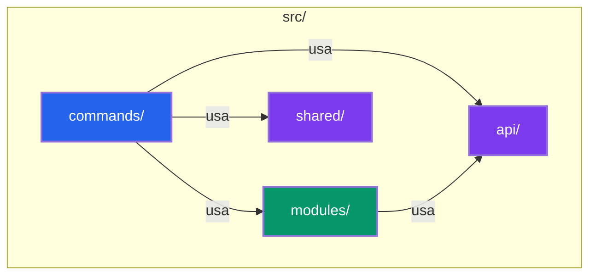

<h1 align="center">
  
  <br><br>
  Projex CLI
</h1>

<p align="center">
  <a href="#features"></a>
  <a href="#installation"></a>
  <a href="#development"></a>
</p>

---

## Descripción

**Projex CLI** es una herramienta de línea de comandos para gestionar flujos de trabajo de proyectos con comandos de Git, VTEX y Bash. Permite automatizar tareas comunes de desarrollo, versionado, despliegue y documentación, facilitando la colaboración y la estandarización en equipos.

### Características Principales

- 🔄 **Automatización Git**: Inicialización, commits convencionales, release management y changelog
- 🔗 **Integración VTEX**: Login, backup, deploy y ejecución de scripts en plataformas VTEX
- 💻 **Bash Automation**: Ejecución de comandos en múltiples directorios con soporte para prompts interactivos
- 🏷️ **Pull Request Labels**: Sugerencia automática de etiquetas basada en análisis de cambios
- 🤖 **DevOps Ready**: Plantillas y configuración para Azure DevOps CI/CD pipelines

---

## Tabla de Contenido

- [Descripción](#descripción)
  - [Características Principales](#características-principales)
- [Instalación](#instalación)
  - [Requisitos del Sistema](#requisitos-del-sistema)
  - [Instalación Global](#instalación-global)
  - [Uso Local](#uso-local)
- [Comandos Principales](#comandos-principales)
  - [Git Commands](#git-commands)
  - [VTEX Commands](#vtex-commands)
  - [Bash Commands](#bash-commands)
  - [Pull Request Commands](#pull-request-commands)
- [Desarrollo Local](#desarrollo-local)
  - [Setup del Entorno](#setup-del-entorno)
  - [Comandos de Desarrollo](#comandos-de-desarrollo)
  - [Ejecución de Tests](#ejecución-de-tests)
- [Publicación en npm](#publicación-en-npm)
- [Documentación Detallada](#documentación-detallada)
- [Autocompletado de Comandos](#autocompletado-de-comandos)
- [Estructura del Proyecto](#estructura-del-proyecto)
  - [Convenios de Código](#convenios-de-código)
- [Contribuir](#contribuir)
- [Licencia](#licencia)

---

## Instalación

### Requisitos del Sistema

- **Node.js**: >=18.0.0
- **npm** o **pnpm** para la gestión de dependencias

### Instalación Global

```bash
npm i -g projex
```

Después de instalar globalmente, puedes usar `projex` desde cualquier directorio:

```bash
projex --help
```

### Uso Local

Para vincular el CLI localmente (útil durante el desarrollo):

```bash
sudo npm link projex
# o usando pnpm
pnpm link -g .
```

---

## Comandos Principales

Consulta todos los comandos disponibles con:

```bash
projex --help
projex <topic> --help
```

### Git Commands

Comandos para gestionar el repositorio Git y workflows de release.

| Comando                              | Descripción                                                                    |
| ------------------------------------ | ------------------------------------------------------------------------------ |
| `git init`                           | Inicializa archivos base para documentación y versionado en un repo Git        |
| `git setup conventional`             | Configura commits convencionales con Husky y Commitlint                        |
| `git setup devops template`         | Añade plantillas y carpetas necesarias para Azure DevOps                       |
| `git update changelog`              | Actualiza el changelog con los últimos cambios                                 |
| `git clone`                          | Clona repositorios indicados                                                   |
| `git release`                        | Bump de versión (semver), commit y push automático                            |

**Ejemplo de uso del release:**

```bash
projex git release --yes
# Esto ejecutará: version bump → changelog update → tag creation → push
```

### VTEX Commands

Comandos para automatizar procesos en la plataforma VTEX.

| Comando                              | Descripción                                                                    |
| ------------------------------------ | ------------------------------------------------------------------------------ |
| `vtex login`                         | Login en VTEX usando API key/token                                             |
| `vtex run-script`                    | Ejecuta scripts desde manifest.json o package.json                             |
| `vtex cms backup`                    | Descarga archivos de checkout VTEX localmente                                  |
| `vtex cms deploy`                    | Despliega archivos locales en el checkout VTEX                                 |
| `vtex run`                           | Ejecuta comandos aceptando preguntas "Yes/No" automáticamente                  |

### Bash Commands

Comandos para ejecución de scripts y automatización con bash.

| Comando                              | Descripción                                                                    |
| ------------------------------------ | ------------------------------------------------------------------------------ |
| `bash run`                           | Ejecuta un comando en uno o varios directorios                                 |

### Pull Request Commands

Herramientas para el flujo de trabajo de Pull Requests.

| Comando                              | Descripción                                                                    |
| ------------------------------------ | ------------------------------------------------------------------------------ |
| `pull-request labels suggest`        | Sugiere etiquetas para PRs basadas en análisis de cambios                     |

---

## Desarrollo Local

### Setup del Entorno

```bash
npm install
# o usando pnpm
pnpm install
```

### Comandos de Desarrollo

```bash
npm run dev          # Desarrollo con nodemon (reinicio automático)
npm run build        # Compilar TypeScript → dist/
npm run lint         # Linter estático con eslint-config-oclif
npm run test:run     # Ejecutar tests sin watcher
npm run test:cov     # Tests con reporte de cobertura (objetivo: 87%)
```

### Ejecución de Tests

El proyecto usa Vitest como framework de testing. Los tests están ubicados en `test/` y siguen la misma estructura que los módulos:

- **Unit tests**: `test/modules/<domain>/`
- **Integration tests**: `test/api/`

Para ver resultados de cobertura detallados:

```bash
npm run test:cov
# Genera reporte en el archivo de cobertura configurado en vitest.config.ts
```

---

## Publicación en npm

El proceso de publicación es automatizado y sigue semver:

```bash
npm run postrelease
```

Este comando ejecuta automáticamente:
1. Bump de versión según commits convencionales
2. Actualización del CHANGELOG.md (formato Keep a Changelog)
3. Creación del tag Git
4. Push al registro remoto

---

## Documentación Detallada

La documentación completa se encuentra en la carpeta [`docs/`](docs/) con diagramas Mermaid y explicaciones técnicas:

- [Arquitectura General](docs/architecture.md): Diagramas de arquitectura, flujos de datos y patrones de diseño
- [Etiquetas de Pull Request](docs/pull-request-labels.md): Sugerencia automática de etiquetas para PRs
- [Azure DevOps](docs/azure-devops-usage.md): Integración CI/CD y troubleshooting
- [Gestión de Releases Git](docs/git-release-management.md): Versionado semver y changelog automatizado
- [Workflows VTEX](docs/vtex-workflows.md): Automatización para la plataforma VTEX (login, backup, deploy)
- [Automatización Bash](docs/bash-automation.md): Ejecución de comandos en múltiples directorios
- [Setup Git & Commits Convencionales](docs/git-setup-conventional.md): Estándares de commits con Husky y Commitlint
- [APIs y Utilidades Core](docs/core-apis-utilities.md): APIs internas, logging, tablas renderizadas y utilidades compartidas

---

## Autocompletado de Comandos

Projex CLI soporta autocompletado para bash, zsh y fish usando el plugin oficial `@oclif/plugin-autocomplete`.

Para habilitar el autocompletado:

```bash
projex autocomplete
```

Sigue las instrucciones específicas que se mostrarán en tu terminal.

---

## Estructura del Proyecto

### Convenios de Código

- **Comandos CLI**: Cada comando es un archivo TypeScript en `src/commands/<domain>/<command>.ts` siguiendo patrones oclif
- **Lógica de Negocio**: Compartida en `src/modules/`, organizada por dominio en subcarpetas
- **APIs y Utilidades Core**: En `src/api/` — constantes, manejo de directorios, tablas, prompts interactivos
- **Utilidades Compartidas**: En `src/shared/` — logging (winston), utilidades de archivos, git helpers, versiones

### Diagrama del Proyecto



---

## Contribuir

El proyecto sigue **Conventional Commits** 1.0.0 y [Semantic Versioning](http://semver.org/spec/v2.0.0.html). Consulta la documentación para detalles de arquitectura y patrones de diseño.

### Flujos Recomendados

1. **Clonar el repositorio**: `projex git clone <repo-url>`
2. **Setup del entorno**: `npm install`
3. **Configurar commits convencionales**: `projex git setup conventional`
4. **Desarrollar cambios** con `npm run dev`
5. **Ejecutar tests**: `npm test` o `npm run test:cov`
6. **Crear un PR** y usar `projex pull-request labels suggest`

---

## Licencia

Este proyecto está bajo la licencia MIT. Consulta el archivo [LICENSE](LICENSE) para más detalles.